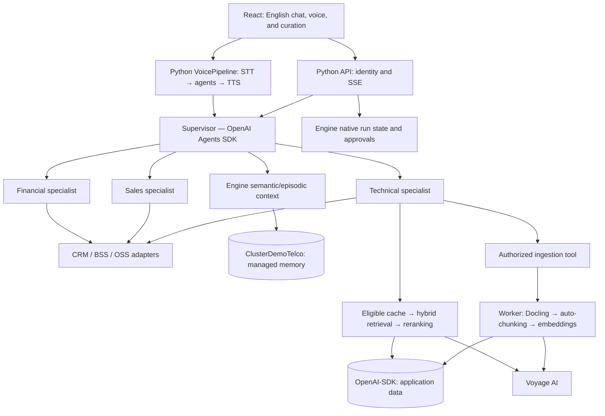

# Telecom agent framework: implementation plan

**Status:** Phase 0 compatibility is complete for the explicitly accepted demo scope on 2026-10-29; the implementation/evidence checkpoint was published as `43746c6`; [publication/CI status](docs/runbooks/REPOSITORY_SETUP.md) records the publication checkpoint and passing push/PR CI for the disconnect-test fix `60ef97b`. Phase 1 application foundation is published and merged; [FND-003](docs/tasks/FND-003-FOUNDATION.md) records validation. Phase 2 is complete for the bounded demo; [VERT-001/002](docs/tasks/VERT-001-JOURNEY.md) records local implementation, live Engine acceptance and the user-confirmed audio repair. See the authoritative [Phase 0 checkpoint](docs/compatibility/PHASE_0.md) for tested versions, accepted limitations and remote restoration evidence. Earlier planning findings below are historical where superseded by that checkpoint.

**Language:** documentation, code identifiers, comments, prompts, configuration, navigation, user-facing UI, and sample chat/voice conversations will all be English.

**Current ownership decision:** [ADR-0018](docs/adr/0018-engine-feature-precedence.md) takes precedence over earlier proposed SDK/application ownership of overlapping platform features. Engine owns those capabilities; the SDK retains orchestration. The user subsequently authorized a [bounded custom adapter](compatibility/openai_engine_adapter/README.md); its local proof does not establish hosted compatibility.

## 1. Intended outcome

Deliver an executable, adaptable reference asset for architects, developers, and builders: a small reusable Python agent package, a complete telecom example, and a React application. Use uv for Python dependencies and OpenAI Agents SDK for orchestration. Preserve the user's targets of the latest stable Python and MongoDB 9; availability and dependency compatibility must be verified before pinning versions.

The asset borrows useful concepts from LangGraph and Deep Agents—specialists, task state, persistent context, and resumable actions—without claiming feature parity or introducing another orchestration framework by default.

Initial scope includes both text chat and browser voice agents. Working assumptions are synthetic customer data, simulated CRM/BSS/OSS integrations, and a local application connected to MongoDB Atlas. PSTN/SIP telephony, live billing, and corporate integrations are explicit extensions. Real AI, embedding, and database providers form the integration demo; offline doubles are clearly labeled simulations.

## 2. Critical compatibility decisions

**Implementation update:** Phase 0 passed for the accepted demo scope, including split Python dependency environments, hosted custom SDK orchestration, Engine memory/native review, application identity and restricted database permissions, search/provider controls, real microphone/listening, and bounded injected failures. The agent runtime remains Python 3.15.2; CPU Docling/OCR uses the approved separate Python 3.14.6 environment. Exact versions, limits and acceptance evidence live in the [Phase 0 checkpoint](docs/compatibility/PHASE_0.md). The component design below describes the intended full application; Phase 2 implementation and acceptance are recorded in VERT-001/002; Phase 3 bounded memory/recovery passed in [MEM-001](docs/tasks/MEM-001-MEMORY.md). Later PDF retrieval/evaluation features remain planned.

| Topic | Evidence and planned decision |
|---|---|
| OpenAI orchestration | Use the supervisor/manager pattern with specialists exposed through `agent.as_tool()`. Keep the supervisor responsible for the final response. |
| Engine memory | Official documentation supports standalone use of `agent_engine_sdk_memory`, including `Memory` and `MemoryRequestContext`. Use this as the memory foundation for the OpenAI application, with an adapter for SDK session semantics where necessary. |
| Engine deployment | The documented runtime integration supports LangGraph/LangChain through `agent-engine-sdk-langgraph`. Native OpenAI Agents SDK compatibility has not been established. A deployment bridge requires a proof of concept before it can be called supported or complete. |
| Engine maturity | Agent Engine is Public Preview without an SLA/SLO. Treat runtime deployment as a preview target and document operational limits. |
| MongoDB 9 | Official release notes confirm MongoDB 9 as the current stable release. Target MongoDB 9 and verify the selected Atlas/topology feature combination. Do not silently substitute another major version. |
| Python latest stable | Python.org identifies Python 3.15.2 as the current stable release in this research. Resolve the complete uv dependency graph against that target. The user authorized a Python 3.14 CPU-only Docling compatibility experiment; the agent runtime remains Python 3.15.2. |
| PDF ingestion | OpenAI supports PDF input and hosted File Search, but these do not establish the required exportable parser pipeline into Voyage/MongoDB. Use IBM Docling for this pipeline. |
| Voyage auto-chunking | Confirmed for `voyage-context-4`; use its native auto-chunking rather than treating contextual embeddings as manual chunking. |
| Automatic embeddings | Prefer MongoDB Auto Embedding wherever the documented model, dimension, index, and query contracts support the required behavior. Use direct Voyage calls for unsupported paths; preserve the requested models. |

**The principal integration risk is the Engine runtime, not standalone Engine memory.** Keep OpenAI Agents SDK as requested. Build and validate the memory integration independently. For Engine deployment, prove that external model/tool calls are correctly wrapped and auditable/replayable through its documented contract; do not silently replace the orchestrator with LangGraph.

## 3. Architecture



This is the intended full-application component design. The bounded custom adapter exists and is validated separately; the complete application graph is not implemented.

| Agent | Responsibilities | Evidence and actions |
|---|---|---|
| Supervisor | Understand intent, gather authorized context, delegate, reconcile results, respond in English | Structured specialist results and business tools |
| Financial | Explain invoices/payments, disputes, and repayment proposals | Current BSS data; confirmation and idempotency for changes |
| Technical | Diagnose issues, retrieve operating procedures, check outages, open tickets | Versioned citations and service status; restricted ingestion tool |
| Sales | Compare plans, check eligibility, propose upsell/cross-sell | Current catalog, prices, conditions, and customer eligibility |

Specialists return typed outcomes such as `resolved`, `needs_information`, `needs_approval`, and `escalate`, with evidence and proposed actions. These are proposed domain contracts, not SDK APIs. Handoffs remain an optional extension for journeys that intentionally transfer conversation ownership.

Identity, tenant, customer, and permissions come from the authenticated backend, not model-selected arguments. Tools enforce authorization, validation, and idempotency independently of model guardrails.

## 4. Memory, sessions, and execution state

**Scope update:** [ADR-0021](docs/adr/0021-demo-semantic-episodic-continuity.md)
supersedes the chronological-restoration requirement below for this demo. The user
selected the validated Engine semantic/episodic continuity; exact transcript
restoration is outside demo scope. Engine ownership and native execution replay
remain unchanged.

Separate three responsibilities:

1. **Session history:** ordered messages and tool calls/results, preserving complete turns and concurrency semantics. Adapt the OpenAI `SessionABC` interface where the Engine memory API is not already compatible. Do not assume its short-term memory automatically satisfies every SDK item contract.
2. **Interrupted execution:** Engine-owned approval/resumption and checkpoint persistence, with versioned SDK state translation only if required by a validated bridge. Do not build a separate application run/approval store. Validate the approving identity, exact action, parameters, expiry, and state version before resuming. A session transcript cannot replace this snapshot.
3. **Durable memory:** use the official Engine memory framework for useful facts, preferences, and episodes across conversations.

The Engine documentation describes chronological short-term turns, asynchronous snapshots, and semantic, episodic, procedural, and taxonomic long-term memory. Semantic/episodic/procedural memories are private to a user by default; taxonomic memory is shared at organization/project scope. `build_context` includes semantic and episodic memory by default; STM and other memory types require explicit inclusion through `enabled_sources`. Durable extraction is asynchronous and eventually available; immediate conversation continuity must use STM/session history. Approved SOPs remain in the separately governed knowledge base, not learned procedural memory. Budgeting, ranking, and deduplication belong to the framework rather than a second competing memory implementation.

Use mem0 as a conceptual reference for extraction, reconciliation, updates, and forgetting. Do not install two authoritative memory managers. The telecom layer controls scope, provenance, retention, validity, and permitted content. Invoices, balances, and eligibility are operational facts queried from their source, not permanent truth inferred from previous chat.

Map authenticated tenant/customer/session identifiers to the Engine organization/project/user/session context after validating the exact schema. Test isolation, including shared taxonomic memory. Avoid duplicating the supervisor transcript for every specialist call. Deletion must invalidate relevant derived memory and caches. Retrieved documents are untrusted data and cannot authorize tool actions or redefine memory policy.

## 5. Technical knowledge ingestion

The technical specialist exposes a typed ingestion tool to authorized knowledge curators. Ordinary customers can query procedures but cannot publish corporate knowledge. The tool creates an asynchronous job and returns `job_id`.

Pipeline:

1. Validate identity, permission, PDF type/size, and upload scope; store the original with configurable storage and compute a content hash.
2. Create a document version; duplicate submissions are idempotent.
3. Docling extracts structure, headings, tables, and page provenance. Enable OCR for scanned PDFs; enforce resource limits and extraction-quality checks.
4. Call `voyage-context-4` contextualized embeddings with document strings (`List[str]`), `input_type="document"`, and `enable_auto_chunking=True`. Documented defaults are `chunk_size=512` and zero overlap, with `chunk_texts` returned. Documentation states a 120K total-token limit with auto-chunking and 32K without; verify batching limits against the pinned SDK and live service.
5. Preserve a reliable mapping from returned chunks to document pages. If usable offsets are absent, align `chunk_texts` to Docling canonical text, handling repeated text and normalization. Validate citations before publication; ambiguous mappings cite the document/section and mark the page unknown. Do not invent page provenance. Oversized documents require explicit section-level partitions and a manifest recording lost cross-partition context.
6. Write chunks, governance metadata, embeddings, and pipeline versions into a staged version. Validate ownership, approval, applicability, dates, lineage, and document risk. Publish only eligible versions after all required data and indexes are ready.
7. Switch the active version and invalidate dependent caches. On failure, retain the previous version and support job retry.

Example synthetic procedures: ONT loss-of-signal, slow Wi-Fi, broadband diagnostics, regional outage handling, router configuration, and ticket escalation. Each includes prerequisites, steps, expected results, escalation criteria, and a version.

### 5.1. Document governance and risk scoring

The [governance contract](docs/DOCUMENT_GOVERNANCE.md) requires information owner, original creation date, server ingestion date, expiry, completed review date, next review due date, effective period, approval, source integrity, applicability, ACL, and replacement lineage. Ingestion date never resets document age or validity. LLM-extracted metadata must be verified against an authoritative source/owner.

Use a versioned, explainable 0–100 risk heuristic: expired +30, overdue/missing review +15, active replacement/confirmed conflict +25, unresolved owner +10, unverified provenance/approval/metadata +10, high business impact +5, rapid change +5. Store factors, evidence, policy version, and assessment time. This is not an error probability. Bands are low 0–19, moderate 20–39, high 40–69, critical 70–100; review or quarantine according to policy. Expired, superseded, revoked, unapproved, unauthorized, or inapplicable content is excluded regardless of score.

Enforce policy at publication, inside both search branches, on authoritative candidate revalidation, and before cached/generated response release. Recompute on time boundaries and changes; request-time validity checks remain mandatory despite background/index lag. Cache source lineage includes governance revision and earliest validity/review deadline. Reviews, overrides, exclusions, and replacement publication are auditable. No low-risk score can override an authorization or validity failure.

The authored [governance demo](examples/telecom/governance/README.md) includes an obsolete procedure scoring 80/100 and a valid replacement scoring 10/100. A negative control can show perfect retrieval and stale-reference scores while the current business outcome is wrong. Compare it with governed abstention and correct replacement retrieval. These are illustrative expectations; actual scores must be measured. The fixtures are Markdown sources now; PDF rendering and end-to-end ingestion are implementation deliverables.

## 6. Retrieval, Matryoshka embeddings, and semantic cache

**Technical retrieval:** apply tenant/ACL/product/language/published-version and governance eligibility filters inside each lexical and vector branch, then use native MongoDB `$rankFusion` and Voyage reranking. Revalidate authoritative source eligibility before using candidates or serving cached answers. Return document/page/version citations. Insufficient valid evidence leads to clarification or escalation.

The MongoDB documentation reports `$rankFusion` support starting with MongoDB 8.0, with same-collection selection/ranked pipelines and the relevant Search/Vector Search indexes. MongoDB 9 is separately confirmed by the release notes; operator documentation does not establish support in every local topology. Validate the actual target topology and index definitions in the compatibility phase. Tune fusion weights and candidate counts with evaluations.

**Automatic-embedding priority:** use MongoDB Auto Embedding wherever the supported contract fits, with separate lexical indexes when hybrid search is needed.

| Path | Selected embedding strategy | Reason and gate |
|---|---|---|
| Semantic cache | MongoDB `autoEmbed`, `voyage-4-lite`, initial 512 dimensions | Supported model/dimension; evaluate false hits and account for asynchronous index lag |
| Application-owned catalog/other retrieval | MongoDB `autoEmbed`, `voyage-4`, initial 1024 dimensions | Supported model/dimension; validate quality, index readiness, and filters |
| Technical SOP knowledge | Direct Voyage `voyage-context-4` for auto-chunking and document/query embeddings | Contextual model is absent from the documented Auto Embedding supported-model list; preserve the requested model |
| Engine-managed memory | Official memory service embedding/index ownership; configure `voyage-4` only after validation | Documentation exposes model/dimension configuration but does not prove internal Auto Embedding support; do not alter its managed collections or add another writer |

AutoEmbed indexes support 256/512/1024/2048 dimensions and text queries through `$vectorSearch`. A single index cannot mix `autoEmbed` and manual `vector` fields. Indexing text beyond 32K tokens truncates it, while oversized query text fails; enforce token limits. Model/dimension changes rebuild the index. Monitor asynchronous readiness and lag. Scalar quantization defaults are separate from Matryoshka dimension selection. Dedicated Atlas clusters require storage auto-scaling; hosted Engine memory has its own M10+ requirement. The documented Auto Embedding inference region is US-based MongoDB-managed Google Cloud infrastructure regardless of the cluster provider; record this deployment property for customers.

**Model assignment:** `voyage-context-4` for technical knowledge; `voyage-4` for durable-memory embeddings and `voyage-4-lite` for semantic cache and eligible query paths, subject to the Engine memory provider interface. The documentation confirms compatible embedding spaces for `voyage-4` and `voyage-4-lite`; do not extend that claim automatically to `voyage-context-4`. Use the documented contextual-model query path for technical retrieval.

Every index records model, dimension, input type, normalization, metric, and pipeline version. Matching dimensions alone do not make different embedding spaces compatible. Re-embedding and index migration must support side-by-side versions and controlled cutover.

**Matryoshka:** `voyage-context-4` documents dimensions 256, 512, 1024, and 2048. Start with a 1024-dimensional knowledge index and compare a separate 256-dimensional profile. Native fusion runs over supported ranked selection branches, followed by candidate reranking. An optional coarse-to-fine profile must prove a legal MongoDB pipeline and recall benefit first; do not insert arbitrary Python transformations or rescoring into a `$rankFusion` input branch. Higher-dimensional refinement cannot recover candidates lost during coarse retrieval, and storing two representations may increase total cost. Voyage documents prefix truncation followed by L2 renormalization; confirm applicability for each selected model and representation. Text reranking with `rerank-3`, or `rerank-3-lite` in an economy profile, is separate from higher-dimensional vector refinement. Choose dimensions only after measuring recall, latency, storage, and cost.

**Semantic cache:** begin with retrieval results and non-personal technical answers within an authorized scope. Include tenant, access scope, knowledge version, policy, model/prompt, embedding configuration, language, and expiration in cache eligibility and metadata. Enforce expiry on reads; delayed TTL cleanup does not make stale entries valid. Calibrate similarity thresholds with both equivalent questions and similar-looking questions with different intents.

Cache never replaces authorization, confirmation, live transactional reads, or action execution. Do not reuse balances, personal information, expired offers, or private content across customers. Document updates, permission changes, relevant memory changes, and policy changes invalidate dependent results. Measure correct hits and false hits, not only hit rate.

## 7. Voice, user experience, and observability

Voice is part of the initial release. Use the documented Python `agents.voice` pipeline (`VoicePipeline` and `SingleAgentVoiceWorkflow`) for speech-to-text → the same supervisor and specialist workflow → text-to-speech. The minimal workflow example does not prove external session compatibility: validate the pinned SDK or implement its documented custom voice-workflow adapter. Implement browser microphone capture, speech playback, transcript, recording state, cancellation, and text fallback. Normalize browser codecs/sample rates, authenticate audio transport, and keep provider credentials server-side. Share the authenticated customer/session and approval policy across voice and chat, preventing duplicate turns. Commit finalized transcripts only; partial recognition is not durable memory. Raw audio retention is off by default. Confirm financial and plan changes explicitly even when requested by voice. Test microphone denial, silence, noisy audio, cancellation, and connection loss. Cancellation does not roll back completed business tools. This baseline is chained turn-based voice, not a claim of full-duplex Realtime behavior. Realtime and telephony adapters require separate capability and deployment validation.

Use React and TypeScript with reproducible builds. Apply MongoDB-inspired colors, typography, spacing, and components; assess LeafyGreen licensing and compatibility. Provide accessible contrast, keyboard navigation, and loading/error states. Describe the asset accurately without implying official certification.

- Support workspace: English chat and voice, safe progress events, specialist activity, cited evidence, and confirmation cards.
- Knowledge curation: PDF upload, ingestion status, extraction quality, active versions, and actionable errors.
- Technical view: tool flow, retrieval, cache, latency, and consumption; never expose internal chain of thought.
- Memory view: authorized facts, provenance, and correction/deletion controls.

The API normalizes SDK streaming into SSE. When output requires validation before disclosure, stream safe progress and release the answer after validation; an output guardrail cannot undo already-transmitted text. Correlate conversation, run, tool, retrieval, and ingestion identifiers. Disable or redact sensitive trace content.

## 8. Proposed repository

```text
AGENTS.md
README.md
pyproject.toml / uv.lock / .python-version
.env.example
packages/telecom_agents/src/telecom_agents/
  agents/            # supervisor and three specialists
  voice/             # STT/agent/TTS workflow and audio contracts
  contracts/         # outcomes, identity, tools, events
  memory/            # official Engine integration and policy
  retrieval/         # Voyage, MongoDB queries, reranking
  cache/             # eligibility and invalidation
  ingestion/         # jobs, Docling, publication
  integrations/      # CRM/BSS/OSS ports and simulators
apps/api/            # ingress/BFF, identity, SSE/audio transport
apps/agent_runtime/  # supervisor/specialists and execution state
apps/knowledge/      # governance, retrieval, cache, publication
apps/worker/         # isolated ingestion and background jobs
apps/web/            # React
configs/             # model roles and execution profiles
infra/               # indexes and validated deployment targets
examples/telecom/    # synthetic corpus, customers, demo scripts
tests/              # behavior, contracts, integration
evals/              # datasets and quality comparisons
tests/load/         # versioned workloads and streaming load clients
docs/adr/           # decisions and tradeoffs
docs/runbooks/      # setup, operation, migration, adaptation
docs/BEST_PRACTICES.md
docs/DOCUMENT_GOVERNANCE.md
docs/SCALABILITY_AND_STRESS_TESTS.md
```

Keep the reusable core small and typed. Clients replace contracts and configuration rather than copying the agent loop. Create concise root and directory-specific `AGENTS.md` instructions with actual setup/build/test commands. Commit dependency locks; frozen CI installs must not silently change versions. Document externally sourced API decisions with dates and links.

## 9. Implementation phases and acceptance criteria

Phase 1 scope is refined by [ADR-0024](docs/adr/0024-phase-one-application-boundaries.md): deliver the working identity journey and actual API/admin entrypoints, retain the separate Engine runtime, and defer knowledge/worker implementations until their feature phase. Do not scaffold empty services. ADR-0021 supersedes exact chronological restoration in the original Phase 3 row; native expurgo remains accepted without additional deletion proof.

**Manual phase checkpoints:** finish one phase, report actual evidence and any remaining limitations, then stop and provide commit commands. The user performs the commit/push manually. Begin the next phase only after the user confirms. A failed compatibility gate remains open; do not call it phase completion.

| Phase | Deliverable | Completion evidence |
|---|---|---|
| 0 — Compatibility | Python/dependency/MongoDB/Engine/Voyage matrix and ADRs | Official versions identified; uv lock, frozen installation, imports, and Python build pass; real minimal memory, Auto Embedding text-query/index, contextual auto-chunking, voice/session, reranking, and native-fusion checks recorded |
| 1 — Foundation | Repository, process boundaries, configuration, demo identity, contracts, CI, proposed ADR review | Independent service entrypoints and write ownership documented; clean setup, lint, types, tests, and React build pass; no committed secrets |
| 2 — Vertical support journey | Supervisor, specialists, simulated business tools, browser voice | Financial/technical/sales and mixed-intent cases route correctly in English chat and voice; microphone/playback/transcript/cancellation work; shared session persists; actions require confirmation; retries do not duplicate effects |
| 3 — Memory and resumption | Engine semantic/episodic context and native execution recovery ([MEM-001](docs/tasks/MEM-001-MEMORY.md)) | Cross-session continuity, authenticated user isolation, concurrency and restart demonstrated; native expurgo accepted under ADR-0019; chronological restoration excluded under ADR-0021 |
| 4 — Knowledge | PDF → Docling → governed versions → Voyage → MongoDB → cited answers | Text/scanned PDFs and governance fixtures ingested; ownership/dates/risk enforced; idempotent retry, eligible publication, hybrid retrieval, and reranking evidenced |
| 5 — Quality and cache | Semantic cache, Matryoshka evaluation, stale-document experiment | Retrieval, faithfulness, stale-reference correctness, current business correctness, and source eligibility reported separately; expiry/review/replacement cache invalidation proven |
| 6 — Experience and packaging | React, best-practices guide, ADRs, reproducible demo | A new developer completes setup/build/demo, inspects governance decisions, and adapts a tool/procedure; documentation distinguishes planned and verified controls |
| 7 — Engine runtime target | Validated entrypoint and integration bridge | OpenAI orchestration, external calls, memory, auditing/replay, and restart semantics work under the documented Engine contract; otherwise this requirement remains explicitly incomplete |
| 8 — Scalability and resilience | Isolated load environment, workloads, dashboards, and results | Run mock-provider capacity and bounded real-provider profiles separately; demonstrate ingestion isolation, scale-out/session correctness, overload recovery, cost accounting, and governance under load |

Independent work can overlap, but external integration cannot pass using only doubles. If a requested service/version is unavailable, its gate stays open and the impact is documented. Establish quality, latency, and cost baselines before setting optimization targets.

The Engine contract uses an application module, `@app.entrypoint`, `app.run`, and an `agent.yaml` entrypoint rather than the application's own HTTP server. Memory service enablement uses `features.memory: true`, `app.memory`, and a Voyage API key. Verify the exact configuration schema and required wrappers (`app.tool`/`app.llm`) before implementing the bridge. A standalone FastAPI application is not by itself an Engine deployment.

## 10. Demo and verification

Main story: a customer reports slow internet in English, first by voice and then by chat in the same session. The supervisor calls the technical specialist, retrieves a cited procedure, checks outages and the current plan, involves financial support when charges are relevant, and asks sales for an eligible offer when appropriate. Confirmation precedes a simulated plan change. A later session recalls a confirmed preference without reusing stale transaction values.

Additional scenarios: curator ingestion; customer ingestion denied; valid semantic-cache reuse; document update invalidating cache; similar questions from two isolated tenants; restart/resume; failed external tool; malicious instructions inside a PDF; missing evidence and escalation.

Add the stale-document governance scenario: recently ingested but obsolete source; excellent metrics against stale labels; incorrect current action; then exclusion/escalation or valid replacement. Show owner, date lineage, risk factors, retrieved versions, grader reference date, and simulated business outcome side by side. Never present “100% accuracy” without naming its reference, metric, sample size, and temporal applicability. Expand the fixture with paraphrases, firmware mismatch, missing owner/dates, review boundaries, and concurrent cache revocation.

Normal CI uses deterministic unit and contract doubles. A separate credentialed integration suite explicitly calls OpenAI, Voyage, MongoDB, and Engine memory. Agent evaluations measure tool choice, authorization, usefulness, grounding, and escalation rather than exact LLM wording. Record cost, tokens, and component latency.

The final README includes implemented commands for setup, seed, index creation, ingestion, run, build, and tests, with service prerequisites. The adaptation guide covers a new domain, tools, corpus, models, memory policy, and deployment.

## 11. Review findings and remaining decisions

The design can use OpenAI orchestration and official Engine memory without claiming native Engine runtime support. This separation removes an unnecessary dependency between memory implementation and deployment research while preserving both requested goals.

Native Voyage auto-chunking is confirmed, so a second manual chunk-size policy should not replace it. Docling remains responsible for extraction and provenance. Matryoshka, hybrid fusion, and reranking solve different stages; adding all three must demonstrate a measurable benefit.

Open gates: latest stable Python compatibility; MongoDB 9 target topology and feature validation; real Engine/OpenAI deployment compatibility; validated Engine memory model/dimension configuration; source-to-page alignment after auto-chunking; and access/credentials for integration tests. The language decision is settled: English throughout. Chat and browser voice are required initially; synthetic integrations and Atlas remain the deployment/demo assumptions unless the user changes them. MongoDB Auto Embedding is preferred wherever verified compatible.

## 12. Architecture Decision Records

Maintain [individual ADRs](docs/adr/README.md) with status, accountable owner, context, decision, alternatives, consequences, validation evidence, and revisit triggers. ADRs 0001–0009 describe proposed full-application decisions. Later records define the accepted Phase 0 scope; ADR-0017 supersedes ADR-0011. Use the ADR index and current checkpoint for decision and evidence status.

| ADR | Decision |
|---|---|
| 0001 | Separate orchestration framework from agent platform and prove runtime compatibility |
| 0002 | Separate ingress, agent runtime, knowledge service, and ingestion workers; avoid one service per specialist |
| 0003 | Separate conversation, durable memory, and interrupted execution state |
| 0004 | Prefer native Auto Embedding while preserving contextual knowledge and native hybrid retrieval |
| 0005 | Enforce document ownership, validity, applicability, and risk independently of relevance |
| 0006 | Evaluate against independent time-valid truth, with explicit stale-reference negative controls |
| 0007 | Enforce cost budgets, authorization, idempotency, and guardrails outside prompts |
| 0008 | Share the agent workflow across chat and browser voice |
| 0009 | Constrain model outputs and use deterministic business rules and response templates |
| 0010 | Use MongoDB as the integrated operational, full-text, and vector data platform |
| 0011 | Historical single-cluster decision; superseded by ADR-0017 |
| 0017 | Approved application and shared Engine memory cluster separation |
| 0012 | Use concise AGENTS.md instructions linked to authoritative specifications |
| 0013 | Deliver bounded tasks with explicit acceptance and evidence |
| 0014 | Automate repository checks and add layered validation with implementation |

Accept ADRs after architecture review and required proofs; supersede accepted decisions rather than erasing their history. Add further ADRs when evidence justifies a queue technology, deployment topology, retention policy, or new integration.

## 13. Scaling, service segregation, and stress testing

Follow the [scalability and stress-test design](docs/SCALABILITY_AND_STRESS_TESTS.md). The diagram above shows logical responsibilities; deployment separates independently scalable ingress, agent runtime, knowledge service, and ingestion workers. Keep specialists inside the runtime unless measured needs justify extraction. Isolate voice/interactive concurrency from OCR and bulk embedding. Each service owns writes; sharing a MongoDB cluster initially does not imply shared collection ownership or eliminate contention.

Use stateless replicas, external session/run state, concurrent-turn protection, bounded durable jobs, atomic leases, idempotent consumers, versioned contracts, service authentication, deadline propagation, backpressure, and retry budgets. Use at-least-once delivery with an outbox/equivalent state-event consistency mechanism. A MongoDB job queue is a starting candidate; select a dedicated broker only when measurements justify it. Test shutdown, reconnect, partial publication, provider throttling, and worker recovery.

Build separate infrastructure capacity and bounded real-provider profiles, plus failure injection. Proposed load ladder: 1/5/10/25/50 concurrent sessions, warm/cold cache, voice/chat mixtures, and concurrent text/scanned PDF ingestion; adjust to observed quotas and spend limits. Record arrival rates, audio/token sizes, dataset/index versions, replicas, hardware, Atlas topology, and generator saturation. Measure p50/p95/p99, useful audio latency, successful throughput, queue age, database/index lag, resources, provider errors, cost per resolved conversation, and correctness under load.

Establish workload-specific latency/error/recovery/cost thresholds before acceptance runs; characterize first rather than invent capacity guarantees. Stop at budget/resource limits or invariant violations. No cross-tenant exposure, unauthorized actions, duplicate business effects, or stale-source use is acceptable in the exercised cases. Report mock and real-provider results separately and retain bottleneck/scale-efficiency evidence. This remains a non-production reference asset even after stress tests.

## 14. Best-practices guide

[BEST_PRACTICES.md](docs/BEST_PRACTICES.md) covers framework/platform separation, service boundaries, token economics, authorization and guardrails, document governance, ingestion/retrieval, independent evaluation, memory, caching, voice, observability, scalability, reproducibility, and recovery. Each topic explains implementation consequences and validation. Keep it aligned with ADRs and explicitly distinguish designed controls from implemented/tested evidence.

## 15. Predictable responses and deterministic business behavior

The Agents SDK supports typed outputs and controlled tool workflows; it does not guarantee identical model-generated answers. Separate three contracts:

| Contract | Implementation | Guarantee boundary |
|---|---|---|
| Structured output | `output_type` with Pydantic and supported Structured Outputs | Schema adherence for successful structured responses; values can vary or be wrong. Handle refusals, incomplete responses, and errors explicitly |
| Business decision | Backend validation, explicit state transitions, versioned rules, authoritative tools | Same validated inputs, state, clock, and rule version produce the same decision; natural-language interpretation remains probabilistic |
| Final wording | Approved versioned templates filled with validated authoritative values | Identical text for identical data/template/locale/formatting; does not imply identical synthesized audio |

For invoices, prices, offers, approvals, and action confirmations, use **agent interpretation → parameter validation/clarification → business tools and rules → template rendering**. Obtain amounts and eligibility from business systems and perform calculations in code. Bind confirmations to the exact proposal/version. Do not allow the supervisor or a subsequent LLM call to rewrite rendered contractual or transactional text. Use SDK orchestration for interpretation and specialist work, then enforce rendering at the application response boundary shared by chat and voice.

Technical explanations can use structured, validated generation with citations to eligible documents. Exact wording is not required for these explanations, but source validity and permitted actions remain deterministic backend checks. A perfectly repeatable answer based on an outdated document is still incorrect.

Example: after validating identity and retrieving an invoice, render `Your invoice total is {amount}, due on {due_date}.` The server supplies currency/rounding/date formatting and values. Missing or ambiguous invoice identifiers trigger clarification; the model never fills missing monetary data by inference.

Lower temperature may reduce variation only where the selected model supports it; `temperature=0` is not a determinism guarantee. Do not depend on `seed` as a universal SDK/Responses feature or a correctness control. Pin supported model snapshots where available, prompts, policies, templates, tool schemas, and test data. Reproducibility fixtures also fix clock, history, source versions/order, and tool results. Frozen fixtures explain replay; live decisions must still use current authorized data. Semantic caching and model-based guardrails do not establish determinism.

### Delivery and acceptance

- **Phase 1:** define typed interpretation/outcome schemas, template registry, rendering boundary, and [ADR-0009](docs/adr/0009-deterministic-responses.md).
- **Phase 2:** implement deterministic billing/offer/confirmation rendering, ambiguity handling, and channel-shared business rules. Handle invalid/refused/incomplete model outputs without executing actions.
- **Phase 5:** add repeated-run evaluations separating schema validity, intent/routing agreement, parameter accuracy, decision consistency, factual correctness, and exact text equality. Report run counts and observed variation; repeatability is not accuracy.
- **Phase 8:** exercise the same contracts under concurrency/retries. Assert stable rendering for fixed validated inputs, once-only effects through idempotency, and no unauthorized or stale-source use.

Deterministic unit tests require exact decisions/text for identical fixed inputs. Model evaluations report empirical variation rather than promise zero variation. Change invoice values, source validity, or policy version in counter-tests and require the appropriate changed outcome. Voice tests verify the approved text passed to TTS and business outcome, not byte-identical audio.

Sources already consulted: [Agents SDK definitions and output contracts](https://developers.openai.com/api/docs/guides/agents/define-agents), [Structured Outputs](https://developers.openai.com/api/docs/guides/structured-outputs). See [best practices](docs/BEST_PRACTICES.md#16-constrain-generation-and-render-critical-responses-deterministically).

## 16. Future extension: intent catalogs and knowledge ontologies — out of scope

A future implementation could add versioned intent catalogs, domain ontologies, and an intent classifier to map questions to authorized, applicable context sources. Combine deterministic routing rules for recognized cases with validated classification, clarification/abstention for ambiguity, governed context, and versioned response templates.

These artifacts improve routing consistency and context selection but do not by themselves guarantee deterministic or correct answers. An LLM classifier may vary; even deterministic routing can select a wrong source. A strict guarantee applies only within a defined boundary: the same validated intent, inputs, context versions, policy, and template produce the same rendered output. Natural-language interpretation remains outside that guarantee unless it also uses deterministic rules.

The asset retains the supervisor/specialist routing described above. Building an ontology, maintaining a formal intent catalog, implementing a dedicated classifier/router, and evaluating that extension are explicitly excluded from this delivery. Keep current tool authorization, structured output, document governance, and ambiguity handling in scope. The reusable contracts should permit a later routing adapter without introducing an unused framework now.

## 17. MongoDB data platform, cluster ownership, and Twelve-Factor boundaries

Use MongoDB as the integrated platform for operational data, full-text Search, Vector Search, and native hybrid retrieval. This reduces separate database/search/vector products, external data copies, and application-managed synchronization pipelines. It does not imply one physical process, one index, immediate search consistency, or removal of external AI services. Mutable financial facts and document eligibility still require authoritative reads.

**Two existing Atlas clusters** are approved in [ADR-0017](docs/adr/0017-two-cluster-memory-boundary.md): OpenAI-SDK for application data and ClusterDemoTelco for project-managed Engine memory. Follow the [database/collection ownership design](docs/DATA_ARCHITECTURE.md): `telecom_demo_runtime`, `telecom_demo_knowledge`, `telecom_demo_ingestion`, and `telecom_demo_business`, plus separate eval/load namespaces. Engine and Auto Embedding internal namespaces retain official ownership and naming. Prove Engine can access its designated memory cluster; application connectivity is independent evidence.

Use separate least-privilege identities, service-owned writes, collection lifecycle policies, schema validation, tenant/ACL filters, and deployment-allowlisted database names. API ingress does not receive broad database access. Hybrid search stays on the relevant service-owned collection; cross-domain access goes through contracts. Avoid databases per agent and collections per tenant/day as a default partitioning scheme.

Twelve-Factor alignment covers explicit dependencies, injected configuration/secrets, attached backing services, build/release/run separation, stateless processes, port binding, independent process scaling, disposability, parity, logs, and one-off admin tasks. It does not itself enforce database or tenant isolation. Logical databases share physical resources and administrative/failure boundaries; measure contention and aggregate pools.

Phase 1 delivers namespace/role/config contracts and migrations. Phase 4 verifies native search over owned collections and index freshness. Phase 8 runs isolated application eval/load databases on OpenAI-SDK with separate identities, budgets, scheduled windows, and invariants. Test allowed/denied service access, forbidden demo-to-eval access, tenant isolation, backup/recovery assumptions, and search lag. Record real evidence before claiming enforcement.

## 18. Codex repository foundation and development decisions

Intended GitHub repository: https://github.com/vagnerpontesbr/mdb_agents_using_openai_agents_sdk. Root [AGENTS.md](AGENTS.md) now supplies Codex working instructions, invariant-focused review rules, source-of-truth links, real validation commands, and evidence requirements. [CONTRIBUTING.md](CONTRIBUTING.md), [SECURITY.md](SECURITY.md), the [task backlog](docs/tasks/README.md), PR/issue templates, and a repository-check workflow support bounded, reviewable changes.

ADRs 0012–0014 capture instruction design, task delivery, and layered verification. The available standard-library check is `python3 scripts/check_repository.py`; it checks foundation files, local Markdown file targets, and ADR structure. It does not validate external links, anchors, secrets, application behavior, or provider compatibility. Future uv/frontend locks and build/lint/type/contract commands are added only when actually implemented and validated. No global Codex configuration or custom skill is required for routine contribution.

The user initialized Git, fetched the existing history, preserved the remote ignore rules, and published commit `3c29d144af786fcbbd201eb8a990a49858b25b26` on `codex/repository-foundation`. The [Repository checks run](https://github.com/vagnerpontesbr/mdb_agents_using_openai_agents_sdk/actions/runs/40671237487) succeeded for that commit. No PR or merge has been confirmed. The GitHub connector supports reading but returned 403 for writes; this session also encountered CLI network and Git metadata restrictions.

**Agreed Git workflow:** the assistant prepares changes and runs available checks, then provides explicit commands. The user executes commits, pushes, and PR creation in the normal Terminal. The assistant verifies results when read access permits and does not attempt plugin writes. New local edits are not published until the user commits and pushes them. Branch protection and optional Codex GitHub review remain repository-administration tasks. See the [setup runbook](docs/runbooks/REPOSITORY_SETUP.md).

## 19. LLM-as-judge and function-calling examples

LLM-as-judge is part of the evaluation design, not an automatic guarantee supplied by the Agents SDK. Start with offline dataset/trace grading for relevance, faithfulness, completeness, and appropriate escalation. Use independent, time-valid SME references and calibrate grader judgments with human review. Version grader model, prompt/rubric, dataset, and source context. Record disagreement, false pass/fail rates, latency, cost, and grading failures separately from agent failures. A judge must not treat instructions embedded in the answer or retrieved documents as grading policy.

The SDK provides typed tools, tracing, guardrail hooks, and approval interruptions. OpenAI Platform evaluation tools provide dataset/eval/trace-grading surfaces. The application still owns criteria, dataset quality, thresholds, integration, and release decisions. An LLM judge is useful for semantic quality, but not mandatory on every live response and never a substitute for deterministic authorization, source expiry, monetary calculation, eligibility, or idempotency checks.

An optional online judge can inspect selected generated explanations if measured value justifies latency/cost. Before enabling it, specify timeout/failure behavior, hold the answer before text/audio release, bound any rewrite attempts, and escalate instead of looping indefinitely. The default asset profile keeps this online step disabled while deterministic output controls remain active. The stale-document demo must show that a judge can approve a faithful obsolete answer unless current authority is independently checked.

Provide explicit function-calling examples in the implementation:

| Example | SDK mechanism | Required behavior |
|---|---|---|
| Read an invoice | `@function_tool` with typed invoice identifier and authenticated local context | Validate scope; read through the business adapter; return authoritative structured values; render approved text |
| Request PDF ingestion | Typed function tool returning `job_id` | Require curator authorization; enqueue bounded/idempotent work; never run OCR in the interactive call |
| Confirm a simulated plan change | Function tool mediated by Engine human review; SDK interruption translation requires compatibility proof | Bind user/parameters/version; validate current eligibility; resume safely; prevent duplicate effects |

Tool names/arguments suggested by a model do not authorize execution. Business functions remain independently testable beneath the SDK wrapper. Example documentation includes direct deterministic adapter tests and a separate real-model run proving tool selection, arguments, results, denied access, malformed input, failure, and approval behavior. Do not call a mocked adapter test proof of live function calling. These examples are scoped in VERT-001, VERT-002, and RAG-001; graders belong to EVAL-001.

Official sources: [guardrails and approvals](https://developers.openai.com/api/docs/guides/agents/guardrails-approvals), [agent evaluations](https://developers.openai.com/api/docs/guides/agent-evals), [agent definitions](https://developers.openai.com/api/docs/guides/agents/define-agents).

## Sources

- [Requirements](docs/REQUIREMENTS.md)
- [OpenAI SDK research](docs/research/openai-sdk.md)
- [MongoDB Engine research](docs/research/mongodb-engine.md)
- [Supporting architecture research](docs/research/asset-architecture.md)
- [Codex repository workflow](docs/research/codex-workflow.md)
- [Voice agent research](docs/research/voice-agents.md)
- [Document governance](docs/DOCUMENT_GOVERNANCE.md)
- [Stale-document demo](examples/telecom/governance/README.md)
- [ADRs](docs/adr/README.md)
- [Best practices](docs/BEST_PRACTICES.md)
- [Scalability and stress tests](docs/SCALABILITY_AND_STRESS_TESTS.md)

The research notes contain official URLs, confirmed capabilities, and remaining limitations. No live dependency installation, model call, database deployment, or end-to-end test was performed during planning.
